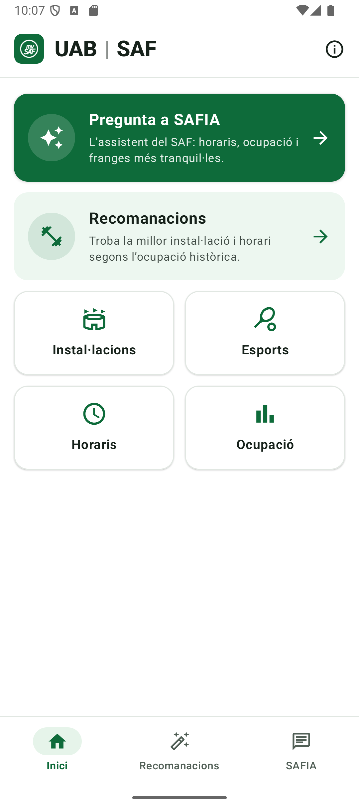
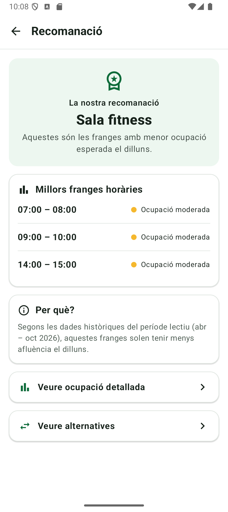
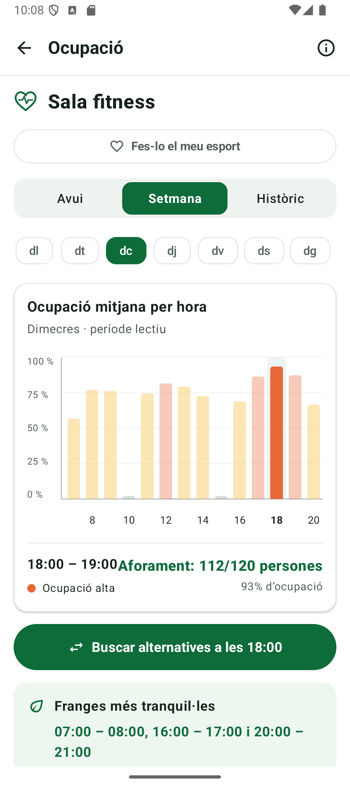
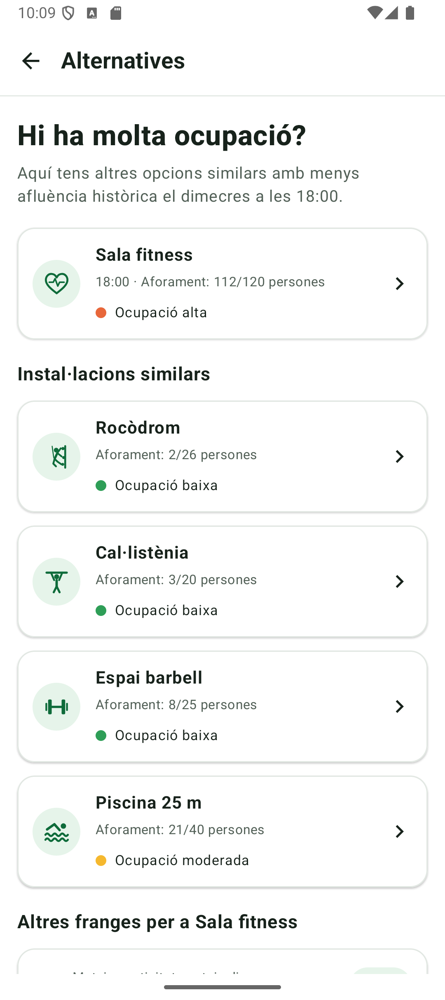
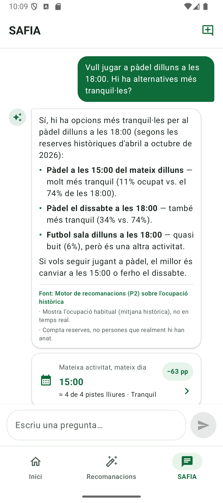
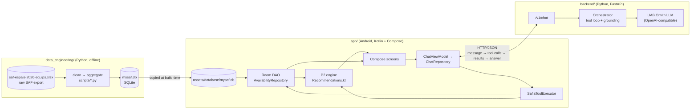
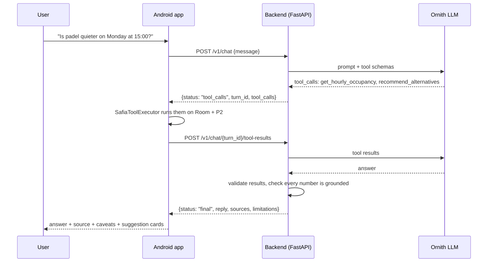

<p align="center">
  
</p>

<h1 align="center">mySAF</h1>

<p align="center">
  An Android app for the UAB sports service (<b>SAF</b>) that tells you <b>when and where it's quieter to train</b>,<br>
  based on historical booking data, plus <b>SAFIA</b>, an AI assistant that answers questions about it.
</p>

<p align="center">
  
  
  
  
  
</p>
<p align="center"><sub>Home · Recommendation · Occupancy · Alternatives · SAFIA chat</sub></p>

Built for **UAB The Hack**. The UI is in Catalan by default, with an English translation.

---

## What it does

| Feature | Description |
|---|---|
| **Recommendations (P2)** | Pick a facility or sport and a day; the app shows the quietest hours, a detailed hourly occupancy chart, and quieter alternatives (same day ±3 h, another day at the same hour, or a similar activity at the same time). |
| **Catalogue & schedules** | 19 facilities and sports (pools, fitness room, studios, climbing wall, padel, tennis, squash, football pitches, …) with capacity and the SAF opening hours. |
| **SAFIA (P3)** | A chat assistant (Catalan / Spanish / English) that answers questions about opening hours, capacity, occupancy and quieter slots. Every figure it gives comes from the app's own database, it cites its source, and it says "I don't know" when the data isn't there. |
| **Methodology** | Explains what the data measures (bookings, not attendance; historical, not real time) and its limits. |
| **Custom launcher icon** | Users can switch the home-screen icon to the logo of their favourite sport. |

## Architecture



The repo has three parts that share **one** copy of the data:

1. **Data pipeline** (`data_engineering/`) turns the raw Excel export from the SAF (≈195k bookings, Apr–Oct 2026) into a small SQLite database of *average and peak occupancy per activity, weekday and hour*. The same file is written into the Android assets.
2. **Android app** (`app/`) ships that database and reads it with Room. All recommendation logic (P2) runs **on the device**, in Kotlin. The app works offline except for the chat.
3. **SAFIA backend** (`backend/`) runs the conversation with the UAB *Ornith* model. It **has no database**: when the model needs data, the backend sends tool calls back to the phone, `SafiaToolExecutor` runs them against Room and the P2 engine, and the backend turns the results into an answer. Because SAFIA and the Recommendations screen use the same code and data, they can't contradict each other. The API key stays on the server.

### A SAFIA turn



At most 3 tool rounds per message; the model may request several tools in parallel in one round. Tools: `list_activities`, `get_facility_info`, `get_opening_hours`, `get_hourly_occupancy`, `find_quieter_slots`, `recommend_alternatives`, `get_dataset_info` (schemas in [`contracts/tools.schema.json`](contracts/tools.schema.json)).

### The database

| Table | Contents |
|---|---|
| `activity` | 19 activities: id, capacity, whether it is counted in **people** (pool, gym, studios…) or in **courts/pitches** (padel, tennis, football…), and the source resources. |
| `hourly_availability` | Activity × period (`lectiu` = term time, or `all`) × weekday × hour (7–20): average and peak occupancy, sample days, share of long block bookings, closed flag. |
| `opening_hours` | General SAF opening hours per weekday. |
| `dataset_info` | Metadata: date range, number of active days, cleaning rule version. |

Occupancy labels: < 50 % *quiet*, < 80 % *moderate*, otherwise *busy*. Hours with too few sample days, closed hours or fitness-room shift changes are never recommended.

## Repository layout

```
.
├── app/                     Android app (Kotlin, Jetpack Compose, Room, Navigation)
│   └── src/main/
│       ├── assets/database/mysaf.db   database generated by the pipeline
│       └── java/com/uab/mysaf/
│           ├── data/                  Room entities/DAO, AvailabilityRepository,
│           │                          P2 engine (Recommendations.kt, Availability.kt),
│           │                          activity catalogue, launcher-icon switching
│           ├── data/chat/             SAFIA HTTP client, DTOs, tool executor
│           └── ui/                    screens, chat, navigation, components, theme
├── backend/                 SAFIA backend (FastAPI + Ornith) — see backend/README.md
│   ├── app/                 API, conversation orchestrator, LLM client, tools, grounding
│   ├── scripts/             chat_cli.py (talk to SAFIA without the app), smoke tests
│   └── tests/               deterministic pytest suite + optional live tests
├── contracts/               Tool contract shared by backend and app (+ recorded fixtures)
├── data_engineering/        Data pipeline
│   ├── data/raw/            original SAF Excel export
│   ├── data/interim/        EDA, duplicates, mappings, cleaned parquet files
│   ├── data/processed/      hourly_availability.csv (same as the DB table)
│   ├── database/mysaf.db    working copy of the database
│   ├── documentation/       data quality report
│   ├── scripts/             analysis, cleaning, DB creation and validation scripts
│   └── tests/
├── docs/
│   ├── safia/               SAFIA architecture and Android integration contract
│   ├── brand/               logo generator (generate_icons.py) and SVG icons
│   └── images/              README screenshots
├── gradle/, build.gradle.kts, settings.gradle.kts   Gradle build
└── requirements.txt         Python dependencies for the data pipeline
```

## Getting started

### Android app

Requirements: Android Studio (recent, AGP 9.1), JDK 11+, an emulator or device with Android 7.0 (API 24) or newer.

1. Open the repository root in Android Studio and let Gradle sync.
2. Run the `app` configuration. Everything except the SAFIA chat works without the backend.
3. For the chat, point the app to your backend in [`app/src/main/res/values/safia_config.xml`](app/src/main/res/values/safia_config.xml) (`safia_base_url`): `http://10.0.2.2:8000/` from the emulator, or `http://<your PC's LAN IP>:8000/` from a phone on the same Wi-Fi. Cleartext HTTP is only allowed in debug builds.

From the command line:

```bash
./gradlew assembleDebug
```

```bash
./gradlew test
```

### SAFIA backend

Python 3.10+. Full instructions in [`backend/README.md`](backend/README.md); in short:

```bash
cd backend && python -m venv .venv && .venv/Scripts/activate && pip install -r requirements-dev.txt
```

Copy `.env.example` to `.env` and set `UTH_KEY` (never commit `.env`), then:

```bash
uvicorn app.main:app --host 0.0.0.0 --port 8000 --reload
```

`python scripts/chat_cli.py` lets you chat with SAFIA without the app, and `python -m pytest` runs the offline test suite.

### Data pipeline

Only needed to regenerate the database. From `data_engineering/`, with the root `requirements.txt` installed:

| Step | Script | Output |
|---|---|---|
| 1 | `explore_excel.py`, `analyze_*.py`, `classify_resources.py` | profiling and resource classification in `data/interim/` |
| 2 | `build_resource_alias.py` | `data/interim/mapping/resource_alias.csv` (canonical resources, people vs courts) |
| 3 | `enrich_inventory.py` | capacities taken from the `Espais` sheet |
| 4 | `clean_data.py` | cleaned bookings split into 15-minute slots (parquet) |
| 5 | `create_database.py` | `database/mysaf.db` **and** `app/src/main/assets/database/mysaf.db` |
| 6 | `validate_database.py` | sanity checks; exits with code 1 on problems |

The database schema must match the Room entities in [`Entities.kt`](app/src/main/java/com/uab/mysaf/data/db/Entities.kt); Room validates it when the app opens the file.

## Tests

| Part | Command | Covers |
|---|---|---|
| App, unit | `./gradlew test` | P2 recommendations, availability mapping |
| App, instrumented | `./gradlew connectedAndroidTest` | DAO queries and the packaged database |
| Backend | `cd backend && python -m pytest` | 14 conversation scenarios, protocol, OpenAI wire format, grounding, security |
| Data pipeline | `cd data_engineering && python -m pytest` | database creation |

## Data caveats

The app is explicit about what the data can and can't say:

- It counts **bookings**, not people who actually showed up.
- It is **historical** (1 Apr – 31 Oct 2026), not real time. By default it uses term time (`lectiu`); July and August are much quieter.
- People-based activities (pools, gym) and court-based ones (padel, tennis) are never compared with each other.
- Climbing wall and calisthenics metrics are not validated, and inventory capacities are provisional; both are flagged in the UI and by SAFIA.

More detail: [`data_engineering/documentation/data_quality_report_mysaf.md`](data_engineering/documentation/data_quality_report_mysaf.md) and [`docs/safia/ARCHITECTURE.md`](docs/safia/ARCHITECTURE.md).

## Further documentation

- [`docs/safia/ARCHITECTURE.md`](docs/safia/ARCHITECTURE.md) — data audit, design decisions and SAFIA architecture
- [`docs/safia/ANDROID_INTEGRATION.md`](docs/safia/ANDROID_INTEGRATION.md) — HTTP API and tool contract for the app
- [`backend/README.md`](backend/README.md) — backend setup, configuration, tests and code map
