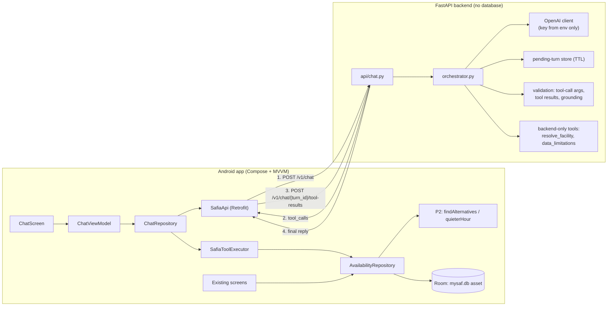

# SAFIA — Phase 1 audit & Phase 2 architecture proposal

Status: **architecture agreed (client-executed tools)**; only the P2 shift-change fix is implemented so far. Based on the repo at commit `203177a`.

---

## 1. Audit — what actually exists

### 1.1 Repository layout

| Area | State |
|---|---|
| `app/` | Android, Kotlin, **Jetpack Compose** + Navigation-Compose (type-safe routes), Room 2.8.4, minSdk 24. 4 screens: Home, Activity, Recommendations, Methodology. Strings in `values/` (Catalan, default) and `values-en/`. |
| `data_engineering/` | Python pipeline (`clean_data.py` → `create_database.py`), pytest, mapping CSVs, quality report. `data_dictionary.md` is **empty**. |
| Backend | **None.** No FastAPI, no OpenAI code. `requirements.txt` only has pandas/pytest stack. |
| Android ↔ network | No `INTERNET` permission, no Retrofit/OkHttp, **no ViewModels** (screens call the repository via `produceState`). |

### 1.2 The real SQLite schema (`mysaf.db`, identical in `data_engineering/database/` and `app/src/main/assets/database/`)

| Table | Rows | Columns |
|---|---:|---|
| `activity` | 11 | `id`, `sort_order`, `is_person_count`, `capacity`, `resource_ids` |
| `hourly_availability` | 2,156 | `activity_id`, `period` (`lectiu`\|`all`), `weekday` (`dl..dg`), `hour` (7–20), `avg_occupied`, `peak_occupied`, `capacity`, `sample_days`, `long_block_share`, `is_closed` |
| `opening_hours` | 7 | `weekday`, `open_min`, `close_min` (Mon–Fri 07–21, Sat 08–20, Sun 09–14) |
| `dataset_info` | 8 | key/value: `date_min=2026-04-01`, `date_max=2026-10-31`, `active_days=193`, `clean_rule_version=SLOT15_LONG240_NIGHT2100_v1`, … |

The 11 activities: `piscina_25m` (40 people), `sala_fitness` (120), `barbell` (25), `callistenia` (20), `rocodrom` (26) — **counted in people**; `padel` (4 courts), `tennis` (5), `esquaix` (3), `pavello` (3), `futbol_sala` (1), `futbol_7_11` (4) — **counted in courts/pitches**.

### 1.3 What the database does *not* contain

- **Directed activities (classes)** — the `Activitats dirigides` sheet is cleaned to parquet but not loaded into the DB (and `DataInscripcio` is unvalidated anyway).
- 16 m pool, cycling room, box training, beach volley, outdoor basketball, badminton sub-courts as separate items — they exist in the inventory/mapping CSVs but are not exposed as activities.
- Per-facility opening hours (only the general schedule).
- Any real-time data.

→ SAFIA must answer "I can't verify that" for these. This is exactly what the official brief asks for P3: *say where each answer comes from and say «no ho sé» when it isn't there.*

### 1.4 P2 — where the recommendation engine lives

P2 is implemented **in Kotlin on the device**:

- `data/Recommendations.kt` → `findAlternatives(...)`: up to one alternative each of `SAME_DAY` (±3 h), `OTHER_DAY` (same hour), `OTHER_ACTIVITY` (same slot, **only activities with the same `is_person_count`**), each ≥ 10 pp quieter.
- `data/Availability.kt` → `quieterHour(...)`, `occupancyLabel` (<50 % quiet, <80 % moderate, else full), `isUsable` (not closed, not low-data, not shift-change), `MIN_SAMPLE_DAYS = 8`, `LONG_BLOCK_SHARE_THRESHOLD = 0.25`.
- `AvailabilityRepository.recommendations(...)` defaults to `period = lectiu`.
- Unit tests exist: `RecommendationsTest.kt`, `AvailabilityMappingTest.kt`.

### 1.5 Data-reliability findings SAFIA must respect

| Finding | Source | Consequence for SAFIA |
|---|---|---|
| `rocodrom` and `callistenia` metrics are `pendiente_validacion` ("Metrica no validada") | `interim/mapping/resource_alias.csv` | Answer qualitatively with an explicit caveat; no percentages presented as confirmed. |
| All people-capacities are `provisional`; padel court 2 has no people capacity | same | Capacity answers carry a "provisional inventory figure" note. |
| Pool record = person, court record = booked court | DB `is_person_count`, methodology strings | Never compare/rank across the two kinds; units always explicit. |
| Data counts **bookings**, not attendance | `methodology_limit_2` | Phrase as "recorded bookings/occupancy", never "people present". |
| Fitness room shift changes at 10 h and 15 h have no data | `methodology_limit_7` | ⚠️ **Gap in P2:** `HourAvailability.shiftChange` is never set from the DB (always `false`), so those hours *are* currently offered as recommendations. Should be fixed once, in P2, so both app and SAFIA benefit. |
| `long_block_share` ≥ 0.25 = club/school blocks | DB | Mention when a slot includes block bookings. |
| Default period `lectiu` (Apr–Jun, Sep–Oct); Jul–Aug much quieter | `methodology_limit_3` | Default to `lectiu`; say so; allow "including summer". |
| Historical only (Apr–Oct 2026) | `dataset_info` | Any "right now / today / currently" question → explain it's historical and offer the typical pattern for that weekday/hour. |

---

## 2. Architecture decision — **client-executed tools** (team decision)

The model runs on the backend, but **every data tool runs on the phone**, against the Room database and the existing Kotlin P2 code (`AvailabilityRepository`, `findAlternatives`, `quieterHour`). The backend never holds a copy of `mysaf.db`.

Why this works: there is a single P2 implementation and a single copy of the data, which is exactly what the Recommendations screen already shows, so SAFIA and the app cannot disagree.

What it costs, and how we contain it:

| Cost | Mitigation |
|---|---|
| Extra round trips (one per tool round) | The model is allowed **parallel tool calls** in one round; rounds capped at 3; typical question = 1 round (2 HTTP calls). |
| Backend can't be tested against the DB on its own | The Kotlin tool executor writes **recorded tool results from the real asset DB** to `contracts/fixtures/*.json` (instrumented test). Backend pytest replays them with a fake executor. |
| Untrusted client returns tool results | Backend validates every result against Pydantic models before it reaches the model; the grounding check only accepts numbers that came from those results. |
| Backend holds turn state between calls | In-memory pending-turn store keyed by `turn_id`, 5-minute TTL. Conversation history itself stays on the phone (stateless across turns). Fine for a single-process MVP. |

The previously recommended option (server-side DB copy + Python port of P2) is documented in git history and can be revisited if latency becomes a problem; the tool contract is identical in both.

---

## 3. Architecture



### 3.1 Turn sequence

1. **Phone → backend** `POST /v1/chat` with `{conversation_id, message, locale, history[], context}`.
2. Backend builds the prompt (system rules + last N turns + echoed `context`) and calls OpenAI with the tool schemas.
3. If the model calls only backend-side tools (`resolve_facility`, `data_limitations`), the backend answers them itself and continues.
4. If it calls phone-side tools, the backend validates the arguments (whitelisted name, `strict` JSON schema, enums for `activity_id` / `weekday` / `period`), stores the turn, and returns `status: "tool_calls"` with `turn_id` and the calls.
5. **Phone** runs each call through `SafiaToolExecutor` (Room + P2, all local, read-only), then `POST /v1/chat/{turn_id}/tool-results`.
6. Backend validates the results, feeds them to the model, repeats 4–5 at most 3 times.
7. Grounding check on the draft: every number must come from this turn's tool results; on failure, one regeneration, then a safe fallback ("I can't verify that figure").
8. Backend returns `status: "final"` with `reply`, `sources[]`, `limitations[]`, optional `recommendation` cards, `needs_clarification`, and the updated `context`.

### 3.2 Tools

All phone-side tools map onto **existing** DAO queries / repository methods, so no new SQL is needed and nothing is generated by the model.

| Tool | Runs on | Backed by |
|---|---|---|
| `resolve_facility(text)` | backend | Alias table ("gimnàs/gym/gimnasio" → `sala_fitness`; "piscina" → `piscina_25m` + note that the 16 m pool isn't covered; ambiguous → candidates). Static, mirrors `ActivityCatalog` ids. |
| `data_limitations(topics[])` | backend | Static text mirroring the methodology strings + validation flags (rocodrom/calistenia unvalidated, capacities provisional). |
| `list_activities()` | phone | `dao.activities()` + `ActivityCatalog` (unit kind). |
| `get_opening_hours(weekdays?)` | phone | `dao.openingHours()`. General SAF schedule only. |
| `get_facility_capacity(activity_id)` | phone | `dao.activity(id)`. Returns unit `people`/`courts`. |
| `get_hourly_occupancy(activity_id, weekdays[], hour_from?, hour_to?, period)` | phone | `repository.dayAvailability(...)` per weekday → load %, label, `closed`, `low_data`, `long_block`, `shift_change`. |
| `find_quieter_slots(activity_id, weekdays[], period, limit)` | phone | **P2** `quieterHour` / usable-row ranking. |
| `recommend_alternatives(activity_id, weekday, hour, period)` | phone | **P2** `repository.recommendations(...)` → `findAlternatives`. |
| `get_dataset_info()` | phone | `dao.datasetInfo(key)` for coverage dates, active days, rule version. |

Not offered, deliberately: directed-activity timetables, real-time occupancy, per-facility hours. The model is instructed to say it can't verify these.

### 3.3 P2 result contract (`recommend_alternatives`)

Serialized by Kotlin (kotlinx-serialization), mirrored by Pydantic models on the backend. Schema lives in `contracts/tools.schema.json`.

```json
{
  "requested": {"activity_id":"tennis","weekday":"dl","hour":18,"load_pct":92,
                "label":"full","occupied":5,"capacity":5,"unit":"courts"},
  "is_already_quiet": false,
  "alternatives": [
    {"kind":"SAME_DAY","activity_id":"tennis","weekday":"dl","hour":15,"load_pct":40,
     "reduction_pp":52,"flags":{"long_block":false,"low_data":false}}
  ],
  "period": "lectiu",
  "metric": "avg booked courts / courts, historical average",
  "no_result_reason": null
}
```

`no_result_reason` ∈ `unknown_activity | closed | no_data | already_quiet | no_alternative_10pp`, computed in the executor from `Recommendations`, so SAFIA can explain *why* there is no recommendation.

### 3.4 HTTP API

```json
// POST /v1/chat
{"conversation_id":"uuid","message":"I els caps de setmana?","locale":"ca",
 "history":[{"role":"user","text":"…"},{"role":"assistant","text":"…"}],
 "context":{"activity_id":"sala_fitness","weekdays":["dl","dt","dc","dj","dv"],"period":"lectiu"}}

// 200 — tools needed
{"status":"tool_calls","turn_id":"t_…","expires_in_s":300,
 "tool_calls":[{"call_id":"c1","name":"find_quieter_slots",
   "arguments":{"activity_id":"sala_fitness","weekdays":["ds","dg"],"period":"lectiu","limit":3}}]}

// POST /v1/chat/{turn_id}/tool-results
{"results":[{"call_id":"c1","ok":true,"output":{…}}]}
//   a failed local call: {"call_id":"c1","ok":false,"error":"DB_UNAVAILABLE"}

// 200 — final
{"status":"final","conversation_id":"uuid","reply":"…","language":"ca",
 "sources":[{"table":"hourly_availability","label":"Ocupació històrica, abr–oct 2026"}],
 "limitations":["historical_only","bookings_not_attendance"],
 "recommendation":null,"needs_clarification":false,
 "context":{"activity_id":"sala_fitness","weekdays":["ds","dg"],"period":"lectiu"}}

// error (4xx/5xx)
{"error":{"code":"LLM_UNAVAILABLE|RATE_LIMITED|TURN_EXPIRED|INVALID_TOOL_RESULT|BAD_REQUEST|INTERNAL",
          "message":"…","retryable":true}}
```

### 3.5 Backend layout

```
backend/
  app/
    main.py                 # FastAPI app, /health
    api/chat.py             # POST /v1/chat, POST /v1/chat/{turn_id}/tool-results
    api/schemas.py          # request/response + tool-result Pydantic models
    orchestrator.py         # tool loop, turn store, context, language
    llm/openai_client.py    # OpenAI SDK wrapper; OPENAI_MODEL from env
    llm/prompts.py          # system prompt: ca/es/en, no-invention, units, historical-only
    tools/schemas.py        # JSON schemas (generated into contracts/tools.schema.json)
    tools/backend_tools.py  # resolve_facility, data_limitations
    validation/             # argument checks, result checks, numeric grounding
  tests/                    # pytest: 14 scenarios replaying contracts/fixtures, secrets scan
  .env.example              # OPENAI_API_KEY=, OPENAI_MODEL=
  requirements.txt
contracts/
  tools.schema.json
  fixtures/*.json           # produced by the Android instrumented test from the real DB
```

### 3.6 Android additions (existing screens untouched)

- `INTERNET` permission; Retrofit + OkHttp + kotlinx-serialization converter (serialization is already in the project); `lifecycle-viewmodel-compose`.
- `data/chat/`: `SafiaApi`, DTOs, `ChatRepository` (runs the request → tool → result loop), `SafiaToolExecutor` (maps tool names to `AvailabilityRepository` / DAO calls; rejects unknown tools and out-of-range arguments a second time).
- `ui/chat/`: `ChatViewModel` exposing `StateFlow<ChatUiState>` (messages, `isSending`, `error`, retry); `ChatScreen`; new `ScreenChat` route plus an entry point on Home.
- Base URL from `BuildConfig` (`http://10.0.2.2:8000` on the emulator). **No API key on the device.**
- `recommendation` cards reuse the existing `RecommendationCard`.
- Tests: `SafiaToolExecutorTest` (unit) and an instrumented test against the prepackaged DB that also writes `contracts/fixtures/`.

---

## 4. Open points for the team

1. ~~Option A vs B~~ → **B, client-executed tools** (decided).
2. ~~Fix `shiftChange` in P2~~ → **done**: `SHIFT_CHANGE_HOURS` in `Availability.kt` now flags fitness 10 h / 15 h, which removes them from recommendations; new unit test in `AvailabilityMappingTest`.
3. Where the backend runs for the demo (laptop on same Wi-Fi vs. a small hosted instance).
4. Whether directed activities should be added to the DB later (requires Data Engineering + SAF confirmation of `DataInscripcio`).
