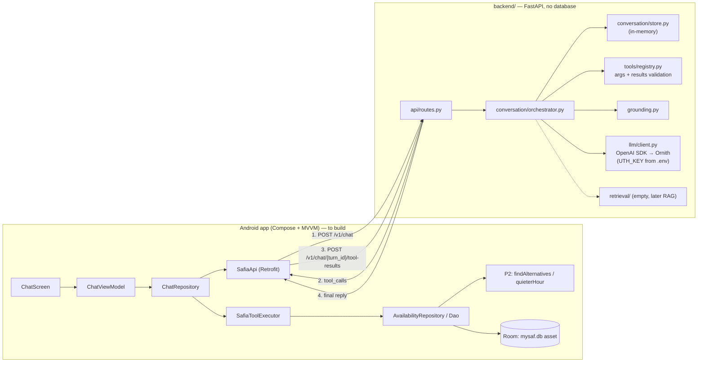

# SAFIA — Architecture

Status: **backend v0.1 implemented** (`backend/`), LLM = UAB **Ornith** (`https://dcc-llm-gw.uab.cat/uabthehack/v1`, OpenAI-compatible). Android chat screen and tool executor: not yet implemented — contract in [`ANDROID_INTEGRATION.md`](ANDROID_INTEGRATION.md). Section 1 is the original audit (commit `203177a`). Based on the repo at commit `203177a`.

---

## 1. Audit — what actually exists

### 1.1 Repository layout

| Area | State |
|---|---|
| `app/` | Android, Kotlin, **Jetpack Compose** + Navigation-Compose (type-safe routes), Room 2.8.4, minSdk 24. 4 screens: Home, Activity, Recommendations, Methodology. Strings in `values/` (Catalan, default) and `values-en/`. |
| `data_engineering/` | Python pipeline (`clean_data.py` → `create_database.py`), pytest, mapping CSVs, quality report. `data_dictionary.md` is **empty**. |
| Backend | **None at audit time.** Now: `backend/` (FastAPI + Ornith), see §3. |
| Android ↔ network | No `INTERNET` permission, no Retrofit/OkHttp, **no ViewModels** (screens call the repository via `produceState`). |

### 1.2 The real SQLite schema (`mysaf.db`, identical in `data_engineering/database/` and `app/src/main/assets/database/`)

| Table | Rows | Columns |
|---|---:|---|
| `activity` | 11 | `id`, `sort_order`, `is_person_count`, `capacity`, `resource_ids` |
| `hourly_availability` | 2,156 | `activity_id`, `period` (`lectiu`\|`all`), `weekday` (`dl..dg`), `hour` (7–20), `avg_occupied`, `peak_occupied`, `capacity`, `sample_days`, `long_block_share`, `is_closed` |
| `opening_hours` | 7 | `weekday`, `open_min`, `close_min` (Mon–Fri 07–21, Sat 08–20, Sun 09–14) |
| `dataset_info` | 8 | key/value: `date_min=2026-04-01`, `date_max=2026-10-31`, `active_days=193`, `clean_rule_version=SLOT15_LONG240_NIGHT2100_v1`, … |

The 11 activities: `piscina_25m` (40 people), `sala_fitness` (120), `barbell` (25), `callistenia` (20), `rocodrom` (26) — **counted in people**; `padel` (4 courts), `tennis` (5), `esquaix` (3), `pavello` (3), `futbol_sala` (1), `futbol_7_11` (4) — **counted in courts/pitches**.

### 1.3 What the database does *not* contain

- **Directed activities (classes)** — the `Activitats dirigides` sheet is cleaned to parquet but not loaded into the DB (and `DataInscripcio` is unvalidated anyway).
- Badminton sub-courts and pitch halves as separate items — they exist in the inventory/mapping CSVs but are not exposed as activities.
- Per-facility opening hours (only the general schedule).
- Any real-time data.

→ SAFIA must answer "I can't verify that" for these. This is exactly what the official brief asks for P3: *say where each answer comes from and say «no ho sé» when it isn't there.*

### 1.4 P2 — where the recommendation engine lives

P2 is implemented **in Kotlin on the device**:

- `data/Recommendations.kt` → `findAlternatives(...)`: up to one alternative each of `SAME_DAY` (±3 h), `OTHER_DAY` (same hour), `OTHER_ACTIVITY` (same slot, **only activities with the same `is_person_count`**), each ≥ 10 pp quieter.
- `data/Availability.kt` → `quieterHour(...)`, `occupancyLabel` (<50 % quiet, <80 % moderate, else full), `isUsable` (not closed, not low-data, not shift-change), `MIN_SAMPLE_DAYS = 8`, `LONG_BLOCK_SHARE_THRESHOLD = 0.25`.
- `AvailabilityRepository.recommendations(...)` defaults to `period = lectiu`.
- Unit tests exist: `RecommendationsTest.kt`, `AvailabilityMappingTest.kt`.

### 1.5 Data-reliability findings SAFIA must respect

| Finding | Source | Consequence for SAFIA |
|---|---|---|
| `rocodrom` and `callistenia` metrics are `pendiente_validacion` ("Metrica no validada") | `interim/mapping/resource_alias.csv` | Answer qualitatively with an explicit caveat; no percentages presented as confirmed. |
| All people-capacities are `provisional`; padel court 2 has no people capacity | same | Capacity answers carry a "provisional inventory figure" note. |
| Pool record = person, court record = booked court | DB `is_person_count`, methodology strings | Never compare/rank across the two kinds; units always explicit. |
| Data counts **bookings**, not attendance | `methodology_limit_2` | Phrase as "recorded bookings/occupancy", never "people present". |
| Fitness room shift changes at 10 h and 15 h have no data | `methodology_limit_7` | **Was a gap in P2:** `shiftChange` was never set from the DB, so those hours were offered as recommendations. **Fixed** in `Availability.kt` (see §4). |
| `long_block_share` ≥ 0.25 = club/school blocks | DB | Mention when a slot includes block bookings. |
| Default period `lectiu` (Apr–Jun, Sep–Oct); Jul–Aug much quieter | `methodology_limit_3` | Default to `lectiu`; say so; allow "including summer". |
| Historical only (Apr–Oct 2026) | `dataset_info` | Any "right now / today / currently" question → explain it's historical and offer the typical pattern for that weekday/hour. |

---

## 2. Architecture decision — **client-executed tools** (team decision)

The model runs on the backend, but **every data tool runs on the phone**, against the Room database and the existing Kotlin P2 code (`AvailabilityRepository`, `findAlternatives`, `quieterHour`). The backend never holds a copy of `mysaf.db`.

Why this works: there is a single P2 implementation and a single copy of the data, which is exactly what the Recommendations screen already shows, so SAFIA and the app cannot disagree.

What it costs, and how we contain it:

| Cost | Mitigation |
|---|---|
| Extra round trips (one per tool round) | The model is allowed **parallel tool calls** in one round; rounds capped at 3; typical question = 1 round (2 HTTP calls). |
| Backend can't be tested against the DB on its own | The Kotlin tool executor writes **recorded tool results from the real asset DB** to `contracts/fixtures/*.json` (instrumented test). Backend pytest replays them with a fake executor. |
| Untrusted client returns tool results | Backend validates every result against Pydantic models before it reaches the model; the grounding check only accepts numbers that came from those results. |
| Backend holds state between calls | In-memory store: conversation history per `conversation_id` (1 h TTL) and the pending tool round per `turn_id` (5 min TTL). Android only sends the new message; it may resend recent `history` to recover after a server restart. Single-process MVP. |

Alternative considered: a server-side DB copy with a Python port of P2 (fewer round trips, easier backend testing, but two P2 implementations). It can be revisited if latency becomes a problem; the tool contract would stay the same.

---

## 3. Architecture (as implemented)

### 3.1 Turn sequence

1. Android `POST /v1/chat` `{message, conversation_id?, locale?}`.
2. Backend appends the message to the conversation and calls Ornith with the system prompt (rules, catalogue, today's weekday, conversation focus) and 7 tool schemas.
3. Each tool call is checked: known name, JSON object, Pydantic validation (enums for activity / weekday / period, hour ranges, no extra fields). Rejected calls are answered to the model with an error and never reach Android.
4. Valid calls → `status: "tool_calls"` with `turn_id` and the calls (ids preserved exactly).
5. Android runs them on Room / Kotlin P2 and posts `results` (one per `call_id`; `ok:false` on local failure).
6. Backend validates every output against the contract (422 if it doesn't match, turn kept open), narrows it to the requested days/hours, adds presentation fields (`time`, `load_pct`, unit, names, validation flags) and sends it to Ornith as `tool` messages in the original call order.
7. Steps 2–6 repeat up to 3 rounds; after that the model must answer (`tool_choice: "none"`).
8. Grounding: every number in the reply must appear in tool results, the user's messages or fixed prompt facts. Otherwise one regeneration; if it still fails, a safe "can't verify" reply (configurable).
9. `status: "final"` with `reply`, `language`, `sources`, `limitations`, `recommendation` (P2 output, if any), `needs_clarification`, `context`.

Compatibility handling for the OpenAI-compatible gateway: `<think>` blocks are stripped; tool calls written as text (`<tool_call>{…}</tool_call>` or JSON) are parsed; `parallel_tool_calls` / `tool_choice` are dropped automatically if the gateway rejects them; missing call ids are generated.

### 3.2 Tools (all executed by Android)

The facility catalogue (ids, names in ca/es/en, aliases, units, unvalidated metrics, what is *not* covered) is in the system prompt, so no backend-side lookup tool is needed. `get_facility_capacity` and `get_resource_information` became one tool, `get_facility_info`.

| Tool | Kotlin backing | Status in Kotlin |
|---|---|---|
| `list_activities` | `dao.activities()` | exists |
| `get_opening_hours(weekdays?)` | `dao.openingHours()` | exists |
| `get_facility_info(activity_id)` | `dao.activity(id)` | exists |
| `get_hourly_occupancy(activity_id, weekdays, hour_from?, hour_to?, period)` | `repository.dayAvailability` | exists |
| `find_quieter_slots(activity_id, weekdays, period, limit)` — P2 | `dayAvailability` + `quietestHours` | **NEW** one-line helper next to `quieterHour` |
| `recommend_alternatives(activity_id, weekday, hour, period)` — P2 | `repository.recommendations` → `findAlternatives` | exists; `no_result_reason` mapping **NEW** in executor |
| `get_dataset_info()` | `dao.datasetInfo(key)` | exists (optional **NEW** `allDatasetInfo()`) |

Not offered, deliberately: directed-activity timetables, real-time occupancy, per-facility hours, prices — SAFIA says it can't verify them.

Exact JSON for arguments and outputs: [`contracts/tools.schema.json`](../../contracts/tools.schema.json) (generated by `backend/scripts/export_contract.py`) and [`ANDROID_INTEGRATION.md`](ANDROID_INTEGRATION.md) §4.

### 3.3 HTTP API

Specified in full in [`ANDROID_INTEGRATION.md`](ANDROID_INTEGRATION.md) §2. Changes from the original proposal: the server keeps the conversation (so `history`/`context` are optional recovery fields), tool results go to `POST /v1/chat/{turn_id}/tool-results`, and responses carry `round` and `needs_clarification`.

### 3.4 Backend layout, configuration and tests

See [`backend/README.md`](../../backend/README.md): Windows setup, `.env` (`LLM_PROVIDER`, `LLM_MODEL=ornith`, `LLM_BASE_URL`, `UTH_KEY`), run/test commands, and the test matrix (scenario, protocol, wire-level SDK, unit, security and live Ornith tests).

### 3.5 Later: RAG

`app/retrieval/` defines a `Retriever` hook whose snippets are added to the system prompt, and `tools/registry.py` supports server-side tools. Either lets document retrieval be added inside this backend with no change to the Android protocol.

---

## 4. Open points for the team

1. ~~Option A vs B~~ → **B, client-executed tools** (decided).
2. ~~Fix `shiftChange` in P2~~ → **done**: `SHIFT_CHANGE_HOURS` in `Availability.kt` now flags fitness 10 h / 15 h, which removes them from recommendations; new unit test in `AvailabilityMappingTest`.
3. Where the backend runs for the demo (laptop on same Wi-Fi vs. a small hosted instance).
4. Whether directed activities should be added to the DB later (requires Data Engineering + SAF confirmation of `DataInscripcio`).
5. Verify Ornith tool-calling behaviour with `backend/scripts/smoke_ornith.py` from a network that reaches `dcc-llm-gw.uab.cat`.
